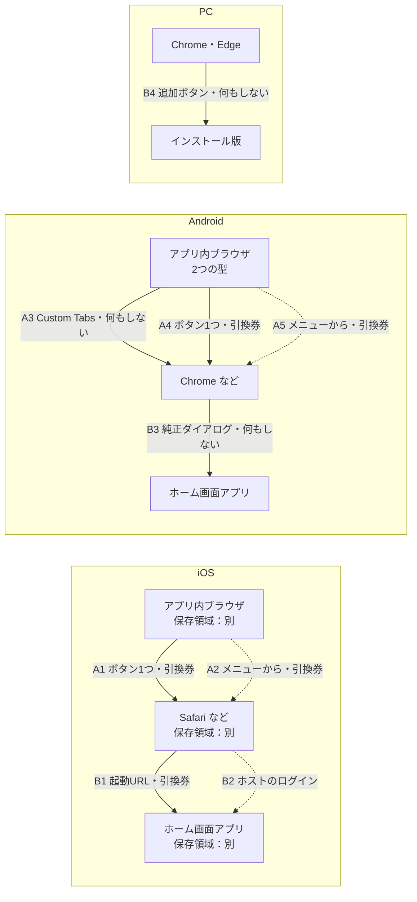
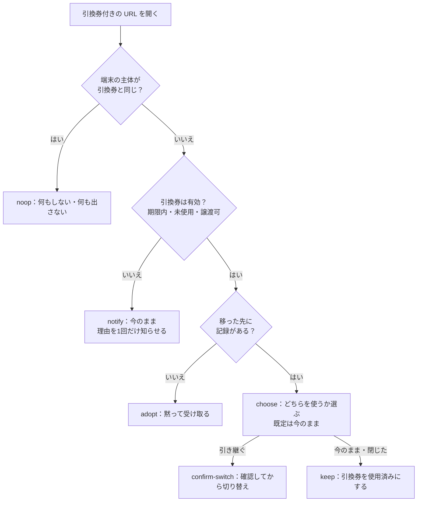

# browser-handoff 設計書

2026-10-16 作成（下書き）。GeoCutter の「再訪の導線」（`GeoCutter-monorepo/docs/unimplemented.ja.md`）から切り出した。

## 1. 何をするか

Web アプリを遊んでいる人が、保存領域の違う場所へ移るときに、ログインなしで「誰か」（アカウント）を持っていく。

- アプリ内ブラウザ（X・LINE・Instagram など）→ 通常のブラウザ
- iOS の Safari など → ホーム画面アプリ

保存領域が同じ場所への移動（Android の Chrome → ホーム画面アプリ、Custom Tabs → Chrome など）では何もしない。

### やらないこと

- アカウントの中身を知ること。キットが扱うのは不透明な ID（`subjectId`）だけ。ID を資格情報（GeoCutter なら `clientToken`）に変えるのはホストの仕事。
- 2つのアカウントをまとめること（統合）。移った先にどちらを置くかを決めるだけ。
- 画面を描くこと。キットは「何を出すか」を返し、文言・カード・図はホストが描く（ヘッドレス）。
- ログイン。届かなかったときの代わり（パスキーなど）はホストが用意する。
- ホーム画面追加の促しの頻度（レベル5・7日・3回）。これもホストのルール。

## 2. 言葉

| 言葉 | 意味 |
|---|---|
| 場所（context） | 保存領域の単位。アプリ内ブラウザ・通常のブラウザ・ホーム画面アプリ |
| 主体（subject） | 運ぶもの。ホストのアカウント。キットからは `subjectId`（文字列）にしか見えない |
| 引換券（ticket） | 1回だけ使える、期限付きの乱数。URL に乗せて運ぶ |
| 用途（purpose） | `escape`（アプリ内ブラウザ → ブラウザ）か `home-screen`（ブラウザ → ホーム画面アプリ）。期限が違う |
| ホスト | キットを使うアプリ（最初は GeoCutter） |

## 3. 分け方

| 置き場 | 持つもの |
|---|---|
| キット `core`（純粋関数・型。ブラウザでもサーバーでも動く） | 場所の判定、外のブラウザの開き方の計画、受け取りの分岐（図2）、引換券の形式 |
| キット `client`（ブラウザ） | 外のブラウザを開く実行と成否の判定、URL への引換券の付け外し、manifest の差し替え |
| キット `server`（Web Crypto だけで書く。Workers・Node・Deno で動く） | 引換券の発行・照会・受け取り・破棄、manifest の生成、保存先の型 |
| ホスト（GeoCutter） | 主体の中身、資格情報の発行、アカウントの概要（レベル・遊んだ回数）、API の入口（認証・回数制限・Turnstile）、保存先の実装（Supabase）、画面と文言、出す条件 |

GeoCutter の中に入るのは「つなぎ」だけになる: API の入口3本、保存先の実装1つ、選ぶ画面などの UI、起動時の1回の呼び出し。

## 4. 経路（図1）

アプリ内ブラウザから出る道は2つある。利用者がリンクをコピーして貼り付ける必要は、どちらにも無い。

- **ボタン1つ（A1・A4）**: ホストの画面のボタン（例「Safari で続きから遊ぶ」）を押すと、キットがアプリごとの方法で外のブラウザを開く。引換券はその URL に乗る。まずこちらを使う。
- **アプリのメニュー（A2・A5）**: ボタンが効かなかったとき、またはアプリに自動で開く方法が無いときは、アプリ自身の「ブラウザで開く」メニューを使ってもらう。キットはアプリ名を返し、ホストがメニューの場所を案内する。引換券は前もって今のページの URL に付けてある（`putTicketInAddressBar`）。そのため、メニューから開いても券が届く。



| 経路 | キットがすること |
|---|---|
| A1（iOS・ボタン1つ） | `planEscape` がアプリごとの開き方を返す（X・WhatsApp・Telegram などは `x-safari-https://`、Instagram は `instagram://extbrowser/`、Threads は `barcelona://extbrowser/`、LINE は `openExternalBrowser=1`）。ホストのボタンのクリックの処理の中で `escapeToBrowser` が実行し、開けたかを判定する |
| A2（iOS・アプリのメニュー） | A1 が効かなかったとき、またはアプリに手段が無いとき、`fallback: menu` とアプリ名を返す。ホストはメニューの場所（下の表）を案内する。引換券は今のページの URL にも付けてあるので、メニューから開いても届く |
| A3（Android） | Custom Tabs 型と分かれば `storage: shared` を返し、引換券を出さない |
| A4（Android・ボタン1つ） | `intent://…#Intent;scheme=https;end` で既定のブラウザを開く。A1 と同じく、ボタンのクリックの処理の中で呼ぶ |
| A5（Android・アプリのメニュー） | A2 と同じ |
| B1（iOS・Mac の Safari） | 追加の手順を出すときに引換券（`home-screen`）を発行し、`<link rel="manifest">` を引換券付きの URL に差し替える。サーバーは `start_url` に引換券を入れた manifest を返す。アプリの初回起動で受け取る |
| B2 | 届かなかったと分かったら（初回起動で端末に主体が無く、引換券も無い）、`fallback: host-login` を返す。ログインはホストの仕事 |
| B3・B4 | `storage: shared` を返し、何もしない。追加のダイアログは pwa-install などに任せる（キットの範囲外） |

### アプリのメニュー（A2・A5、要確認）

各アプリの「ブラウザで開く」メニューの場所。覚えている範囲で書いたもので、まだ実機で確かめていない。8章のデモページで確かめてから、キットが返す手順のデータにする。版によって変わるので、データには確かめた日と版を残す。

| アプリ | iOS | Android |
|---|---|---|
| LINE | 共有 →「Safari で開く」 | 「⋮」→「他のアプリで開く」 |
| X | 共有 →「Safari で開く」 | 「⋮」→「ブラウザで開く」（Custom Tabs 型なら不要） |
| Instagram | 「⋯」→「外部ブラウザで開く」 | 「⋮」→「外部ブラウザで開く」 |
| Threads | 「⋯」→「外部ブラウザで開く」 | 「⋮」→「外部ブラウザで開く」 |
| Facebook | 「⋯」→「外部ブラウザで開く」 | 「⋮」→「外部ブラウザで開く」 |
| TikTok | 版によって無い | 版によって無い |
| その他 | 分からない。「共有」や「⋯」からブラウザで開くよう案内する | 同左 |

メニューが無いアプリでボタン1つも効かなかったときは、ホストが「リンクをコピーしてブラウザに貼り付ける」を最後の手段として出してよい。そのときコピーする URL にも引換券が付く（9章の券の漏れの件を参照）。

### 外のブラウザを開けたかの判定

カスタムスキームの成否は OS から返ってこない。次の4つの合図のどれかが来たら成功とみなす（plugwith.me の 2026 年の実測に沿う）。

- `visibilitychange`（hidden）
- `pagehide`
- `blur`
- 250ms ごとのタイマーが 900ms 以上遅れた（Meta の WebView は `visibilitychange` を確実に出さないため）

猶予（既定 2,500ms）のうちに合図が来なければ、代わり（メニューの案内）は1回だけ出す。次の方法を自動で試し続けることはしない。

Instagram の `extbrowser` は、読み込み後のスクリプトからの遷移を無視する。そのため実際のタップの中で呼ぶ（`escapeToBrowser` はクリックの処理の中で呼ぶことを前提にする）。

## 5. 受け取りの分岐（図2）



`decideRedemption` は純粋関数で、上の図をそのまま実装する。

| 入力 | 意味 |
|---|---|
| `deviceSubjectId` | 移った先にある主体の ID。無ければ `null` |
| `deviceHasRecords` | 移った先の主体に記録があるか（ホストが判定。GeoCutter なら完走1回以上） |
| `ticket.status` | `valid` / `expired` / `used` / `not-transferable`（発行後に元がログインした、など） / `unknown` |
| `ticket.subjectId` | 引換券の主体（`valid` でなくても、照会で分かれば入る） |
| `notifiedBefore` | この引換券についてもう知らせたか（端末に控える） |

| 出力 | ホストがすること |
|---|---|
| `noop` | 何もしない |
| `notify`（理由つき） | 理由を1回だけ出す。`not-transferable` なら「ログインしてください」 |
| `adopt` | `redeem` して資格情報を受け取り、保存する。「続きから遊べます」を出す |
| `choose` | 両方の概要を並べた画面を出す。結果を `resolveChoice` に渡す |

`notifiedBefore` があるのは、ホーム画面アプリがアイコンを押すたびに同じ引換券付きの URL で開くため。2回目以降は `noop` になる（端末の主体が同じなら D1 で、違っても知らせ済みなら黙る）。

## 6. 公開する API（案）

### core

```ts
type Platform = 'ios' | 'android' | 'desktop' | 'other';
type ContextKind = 'in-app' | 'browser' | 'standalone';
type InAppName = 'x' | 'line' | 'instagram' | 'facebook' | 'threads' | 'tiktok'
  | 'telegram' | 'whatsapp' | 'linkedin' | 'other';

interface BrowserContext {
  platform: Platform;
  kind: ContextKind;
  app?: InAppName;                       // kind === 'in-app' のとき
  storage: 'separate' | 'shared' | 'unknown'; // 移る先（ブラウザ／ホーム画面）と保存領域が同じか
}

function detectContext(env: { userAgent: string; standalone?: boolean; displayModeStandalone?: boolean }): BrowserContext;

type EscapeStep =
  | { kind: 'navigate'; href: string }   // x-safari-https:// や intent:// など
  | { kind: 'none' };                    // 自動で開く手段が無い
interface EscapePlan {
  step: EscapeStep;
  fallback: { kind: 'menu'; app: InAppName | 'other'; platform: Platform };
}
function planEscape(context: BrowserContext, targetUrl: string): EscapePlan;

type RedemptionDecision =
  | { action: 'noop' }
  | { action: 'notify'; reason: 'expired' | 'used' | 'not-transferable' | 'unknown' }
  | { action: 'adopt' }
  | { action: 'choose' };
function decideRedemption(input: RedemptionInput): RedemptionDecision;

// 引換券の URL の扱い。パラメータ名は既定 'handoff'。
function withTicket(url: string, ticket: string, param?: string): string;
function readTicket(url: string, param?: string): string | null;
function withoutTicket(url: string, param?: string): string;
```

### client

```ts
// クリックの処理の中で呼ぶ。開けたら 'opened'、合図が来なければ 'fallback'。
function escapeToBrowser(plan: EscapePlan, opts?: { graceMs?: number }): Promise<'opened' | 'fallback'>;

// メニューから開いても届くように、今のページの URL に引換券を付ける（history.replaceState）。
function putTicketInAddressBar(ticket: string): void;
// 受け取ったら（または捨てたら）URL から消す。
function clearTicketFromAddressBar(): void;

// <link rel="manifest"> を引換券付きの manifest URL に差し替える（B1）。
function overrideManifest(manifestUrl: string): () => void; // 戻す関数を返す

// 起動時の受け取りの流れをまとめたもの。ホストは関数を渡すだけ。
interface RedemptionHost {
  deviceSubject(): Promise<{ id: string; hasRecords: boolean } | null>;
  peek(ticket: string): Promise<{ status: TicketStatus; subjectId?: string }>; // ホストの API を呼ぶ
  wasNotified(ticket: string): boolean;
  markNotified(ticket: string): void;
}
function startRedemption(host: RedemptionHost, url?: string): Promise<{ ticket: string; decision: RedemptionDecision } | null>;
```

### server

```ts
interface HandoffStore {
  // 保存するのは引換券のハッシュだけ。
  put(record: TicketRecord): Promise<void>;
  get(ticketHash: string): Promise<TicketRecord | null>;
  // 未使用なら使用済みにして返す。原子的に行うこと（2回目は null）。
  consume(ticketHash: string, now: number): Promise<TicketRecord | null>;
  revokeBySubject(subjectId: string, purpose: Purpose): Promise<void>;
}

interface TicketRecord {
  ticketHash: string;
  subjectId: string;
  purpose: 'escape' | 'home-screen';
  issuedAt: number;
  expiresAt: number;
  usedAt: number | null;
  payload?: string; // ホストが一緒に運ぶ小さなデータ（例: お気に入り）。上限 2KB
}

function createHandoffService(opts: {
  store: HandoffStore;
  ttlMs?: { escape: number; 'home-screen': number }; // 既定 10分 / 60分
  isTransferable?: (subjectId: string) => Promise<boolean>; // 発行時と受け取り時に呼ぶ
  now?: () => number;
}): {
  issue(subjectId: string, purpose: Purpose, payload?: string): Promise<{ ticket: string; expiresAt: number }>;
  peek(ticket: string): Promise<{ status: TicketStatus; subjectId?: string }>;
  redeem(ticket: string): Promise<{ subjectId: string; payload?: string } | { error: TicketStatus }>;
  discard(ticket: string): Promise<void>;
};

// 元の manifest に start_url（引換券付き）を入れて返す。id は変えない。
function renderManifest(base: WebAppManifest, startUrl: string): WebAppManifest;

const memoryStore: () => HandoffStore; // テスト用
```

- 同じ主体・同じ用途で新しく発行したら、古い引換券は無効にする。
- 引換券は 128 ビットの乱数（base64url）。保存は SHA-256 のハッシュだけ。
- 照会（`peek`）は引換券を使用済みにしない。選ぶ画面に概要を出すために使う。
- 回数制限・認証・ログはホストの API の入口でやる。キットはログに引換券を出さない。

## 7. GeoCutter でのつなぎ（参考）

| つなぎ | 中身 |
|---|---|
| `POST /api/handoff/issue` | 今の `userIdentity` を確かめ、匿名なら `issue(userId, purpose)`。ログイン済みなら拒否（ログインで移す） |
| `POST /api/handoff/peek` | `peek` の結果に、主体の概要（レベル・遊んだ回数）を足して返す |
| `POST /api/handoff/redeem` | `redeem` し、その `userId` に新しい `clientToken` を発行して返す |
| `GET /manifest.webmanifest?handoff=` | `renderManifest` で `start_url` を `/play?handoff=…` にして返す |
| 保存先 | Supabase の `handoff_tickets` 表（`consume` は条件付き UPDATE で原子的に） |
| 画面 | 「Safari で続きから遊ぶ」ボタン、メニューの図、選ぶ画面、知らせ |

ホストが決めること（キットの選択肢として出す）: ログイン済みを移すか、完走0回を「記録なし」とみなすか、ログイン済みの端末でも選ぶ画面を出すか、切り替え前の ID を控えるか、お気に入りを `payload` で運ぶか。

## 8. 試し方

- `core` は単体テスト（図2の全分岐、`planEscape` の全アプリ）。
- 実機確認用に小さなデモページを repo に置く（Cloudflare Pages などに出す）。GeoCutter を通さずに次を確かめる。
  - A1: X・LINE・Instagram（iOS）でボタンから Safari が開くか
  - A3/A4: Android の X が Custom Tabs 型か、`intent://` が効くか
  - B1: iOS で差し替えた manifest の `start_url` が使われるか（iOS 26 の「Webアプリとして開く」がオンのとき）
- デモページの結果を見て、`planEscape` の表と B1 を採るかを決める。

## 9. 未決

- repo 名・パッケージ名。仮に `browser-handoff`。他の候補は `carry-on`（「続きから」）、`storage-handoff`、`webview-escape-handoff`。
- 公開するか（今は非公開。公開するなら MIT）。
- 場所の判定を自前で書くか、`inapp-spy`（MIT）に頼るか。依存を増やさないなら自前（UA の表は小さい）。
- 配布の形: npm の非公開パッケージか、GitHub の git 依存か。
- メニューの案内の図をキットが持つか（持つとヘッドレスでなくなる）。今はアプリ名と手順のデータだけ返す案。
- URL に付けた引換券が、リンクの共有で他人に渡る件。A2・A5 のために今のページの URL に券を付けるので、利用者が「リンクをコピー」や共有で URL を人に送ると、券も一緒に渡る。受け取った人の端末に記録が無ければ、図2で黙って受け取られ（adopt）、同じアカウントを2人で持つことになる。対策の候補:
  - 今のページの URL に券を付けるのは、メニューの案内を出すときだけにする。ボタン1つで開けたら URL から消す（`clearTicketFromAddressBar`）。
  - `escape` の期限を短くする（例 10分 → 5分）。
  - `escape` の受け取りでは、記録が無くても黙って受け取らず、「続きから遊びますか？」と1回確かめる（adopt を確認つきにする）。
  - `Referrer-Policy: no-referrer` で、Referer から券が漏れないようにする。
  - どれを既定にし、どれをホストの選択肢にするか。
