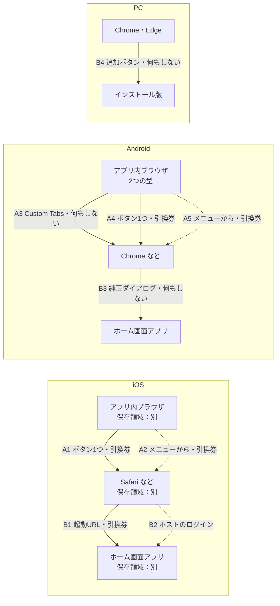
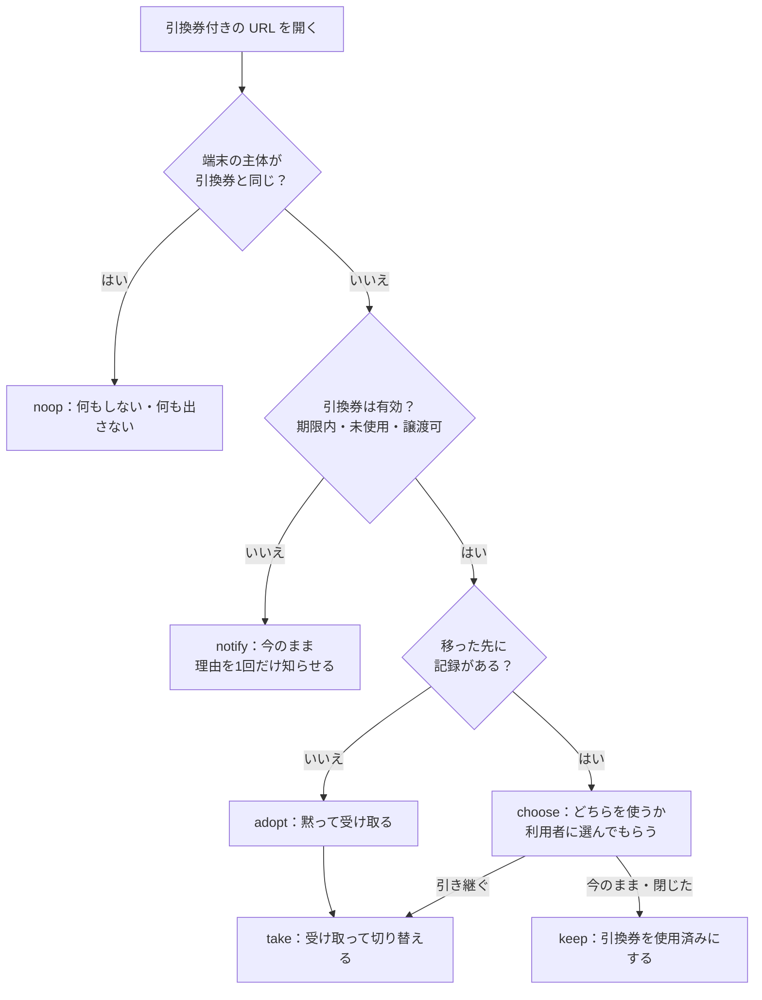

# browser-handoff 設計書

2026-10-16 作成（下書き）。GeoCutter の「再訪の導線」（`GeoCutter-monorepo/docs/unimplemented.ja.md`）から切り出した。

## 1. 何をするか

Web アプリを遊んでいる人が、保存領域の違う場所へ移るときに、ログインなしで「誰か」（アカウント）を持っていく。

- アプリ内ブラウザ（X・LINE・Instagram など）→ 通常のブラウザ
- iOS の Safari など → ホーム画面アプリ

保存領域が同じ場所への移動（Android の Chrome → ホーム画面アプリ、Custom Tabs → Chrome など）では何もしない。

**アプリ内ブラウザは、閉じると記録が消えることがある（2026-10-16、Android の X で確認）**: 匿名のアカウントで1回遊んだあと、引き継がずにアプリ内ブラウザを閉じ、同じリンクをもう一度 X のアプリ内ブラウザで開くと、最初からになった（localStorage などが残っていない）。少なくとも Android の X では、アプリ内ブラウザに置いた記録は「消えやすい」のではなく「閉じたら消える」。外のブラウザへ出す理由はこれで、ホストはボタンを目立たせてよい。LINE・Instagram・iOS で同じかは未確認。

### やらないこと

- アカウントの中身を知ること。キットが扱うのは不透明な ID（`subjectId`）だけ。ID を資格情報（GeoCutter なら `clientToken`）に変えるのはホストの仕事。
- 2つのアカウントをまとめること（統合）。移った先にどちらを置くかを決めるだけ。
- 画面を描くこと、文言を持つこと（ヘッドレス）。キットが返すのは「今どうなっているか」（状態）と「判断に要るデータ」だけ。それを見て、何を・どんな言葉で・どの見た目で出すか（出さないか）はホストが決める。文言はアプリごと・言語ごとに違うので、キットが持つとどのアプリにも合わない。
- ログイン。届かなかったときの代わり（パスキーなど）はホストが用意する。
- ホーム画面追加の促しの頻度（レベル5・7日・3回）。これもホストのルール。

## 2. 言葉

| 言葉 | 意味 |
|---|---|
| 場所（context） | 保存領域の単位。アプリ内ブラウザ・通常のブラウザ・ホーム画面アプリ |
| 主体（subject） | 運ぶもの。ホストのアカウント。キットからは `subjectId`（文字列）にしか見えない |
| 引換券（ticket） | 1回だけ使える、期限付きの乱数。URL に乗せて運ぶ |
| 用途（purpose） | `escape`（アプリ内ブラウザ → ブラウザ）か `home-screen`（ブラウザ → ホーム画面アプリ）。期限が違う |
| ホスト | キットを使うアプリ（最初は GeoCutter） |

## 3. 分け方

| 置き場 | 持つもの |
|---|---|
| キット `core`（純粋関数・型。ブラウザでもサーバーでも動く） | 場所の判定、外のブラウザの開き方の計画、受け取りの分岐（図2）、引換券の形式 |
| キット `client`（ブラウザ） | 外のブラウザを開く実行と成否の判定、URL への引換券の付け外し、manifest の差し替え |
| キット `server`（Web Crypto だけで書く。Workers・Node・Deno で動く） | 引換券の発行・照会・受け取り・破棄、manifest の生成、保存先の型 |
| ホスト（GeoCutter） | 主体の中身、資格情報の発行、アカウントの概要（レベル・遊んだ回数）、API の入口（認証・回数制限・Turnstile）、保存先の実装（Supabase）、画面と文言、出す条件 |

GeoCutter の中に入るのは「つなぎ」だけになる: API の入口3本、保存先の実装1つ、選ぶ画面などの UI、起動時の1回の呼び出し。

## 4. 経路（図1）

アプリ内ブラウザから出る道は2つある。利用者がリンクをコピーして貼り付ける必要は、どちらにも無い。

- **ボタン1つ（A1・A4）**: ホストの画面のボタン（例「Safari で続きから遊ぶ」）を押すと、キットがアプリごとの方法で外のブラウザを開く。引換券はその URL に乗る。まずこちらを使う。
- **アプリのメニュー（A2・A5）**: ボタンが効かなかったとき、またはアプリに自動で開く方法が無いときは、アプリ自身の「ブラウザで開く」メニューを使ってもらう。キットはアプリ名とメニューの場所のデータを返し、ホストがそれを案内する。案内を出すときに、引換券付きの URL でページを読み込み直す（`reloadWithTicket`）。そのため、メニューから開いても券が届く。読み込み直すと画面の状態は消えるので、読み込み直したあとの `startRedemption` が「メニューの案内の途中」（`escapePending`）を返し、ホストは案内をもう一度出す。

キットが返すのは状態だけで、文言はホストが決める（1章）。たとえば、ボタンを押してから結果が出るまでは `escapeToBrowser` が結果待ちになる。その間に「Safari を開いています…」のような表示を出すかどうかはホストが決める。



| 経路 | キットがすること |
|---|---|
| A1（iOS・ボタン1つ） | `planEscape` がアプリごとの開き方を返す（X・WhatsApp・Telegram などは `x-safari-https://`、Instagram は `instagram://extbrowser/`、Threads は `barcelona://extbrowser/`、LINE は `openExternalBrowser=1`）。ホストのボタンのクリックの処理の中で `escapeToBrowser` が実行し、開けたかを判定する。iOS では「Chrome で開く」（`googlechromes://`）も選べる（下の「iOS の Chrome」） |
| A2（iOS・アプリのメニュー） | A1 が効かなかったとき、またはアプリに手段が無いとき、`fallback: menu` とアプリ名を返す。ホストはメニューの場所（下の表）を案内し、そのとき引換券付きの URL で読み込み直す（`reloadWithTicket`）。メニューから開いても届く |
| A3（Android） | Custom Tabs 型と分かれば `storage: shared` を返し、引換券を出さない |
| A4（Android・ボタン1つ） | `intent://…#Intent;scheme=https;end` で既定のブラウザを開く（X は `intent://` を開けないので除き、メニューに任せる）。A1 と同じく、ボタンのクリックの処理の中で呼ぶ |
| A5（Android・アプリのメニュー） | A2 と同じ。ただし Android の Instagram はメニューでは券が届かないので、`fallback: retry` を返し、ホストは「もう一度ボタンを押して『次へ』」と案内する |
| B1（iOS・Mac の Safari） | 追加の手順を出すときに引換券（`home-screen`）を発行し、`<link rel="manifest">` を引換券付きの URL に差し替える。サーバーは `start_url` に引換券を入れた manifest を返す。アプリの初回起動で受け取る。追加してから初めて開くまでに日が空くことがあるので、期限は長くする（6章） |
| B2 | 届かなかったと分かったら（初回起動で端末に主体が無く、引換券も無い）、`fallback: host-login` を返す。ログインはホストの仕事 |
| B3・B4 | `storage: shared` を返し、何もしない。追加のダイアログは pwa-install などに任せる（キットの範囲外） |

### iOS の Chrome（A1、要確認）

iOS の Chrome は、Safari ともアプリ内ブラウザとも保存領域が別。`x-safari-https://` はふだん使いのブラウザに関係なく Safari を開くので、Chrome をふだん使いにしている人は、記録が Safari に移り、そのあと Chrome で開くとまた最初からになる。iOS のページからは、ふだん使いのブラウザも、Chrome が入っているかも分からない。

そのため、iOS では計画に別の開き方を持たせる。

- `plan.browser`: `step` で開くブラウザ（`safari`・`default`）。`default` は、アプリが既定のブラウザに渡す方法（LINE の `openExternalBrowser`、Instagram・Threads の `extbrowser`）で、どのブラウザが開くかはアプリ次第（要確認）
- `plan.alternatives.chrome`: `googlechromes://<host>/<path>`（http なら `googlechrome://`）
- ホストは「Safari で開く」と「Chrome で開く」の2つのボタンを出せる。Chrome のボタンは `flow.press({ browser: 'chrome' })` を呼ぶ
- Chrome が入っていないと、`googlechromes://` へ移っても何も起きず、合図が来ない。ふつうの「ボタンでは開けなかった」（`button-failed`）になり、状態に `browser: 'chrome'` が入る。ホストは「Chrome が入っていないかもしれません。Safari で開く」を勧めればよい。券は同じものを使い続けるので、続けて Safari のボタンを押しても届く
- 要確認: X・LINE・Instagram の iOS のアプリ内ブラウザから `googlechromes://` へ移れるか（アプリが知らないスキームを止めることがある）、移る前に確認が出るか、Chrome が開いたときに合図が来るか
- Android は `intent://` で既定のブラウザ（Chrome 派なら Chrome）が開くので、別の開き方は出さない

### iOS で「ふだん使いのブラウザ」を開けるか（A1、要実機確認）

方針（2026-10-16、GeoCutter）: iOS でも、Safari か Chrome かを選ばせるより、ふだん使いのブラウザを開きたい。`alternatives.chrome` は残すが、GeoCutter は使わない。

調べたこと（実機ではまだ確かめていない）:

- ページから「ふだん使いのブラウザ」を名指しせずに開く URL スキームは無い。`x-safari-https://` は Safari、`googlechromes://` は Chrome を名指しで開くだけ。ふだん使いのブラウザが開くのは、アプリが OS に https の URL を渡したとき（`UIApplication.open`）だけで、アプリ内ブラウザのページからはそれを呼べない。Apple は「Safari を名指しで開く」公式の方法も出していない（`x-safari-https://` は非公開の仕組みで、将来変わりうる）。
- LINE の `openExternalBrowser=1`: LINE が OS に渡すので、ふだん使いのブラウザが開くと書いている記事が多い（公式の説明は見つけていない）。
- Instagram・Threads の `extbrowser`: 説明が見つからない。中身が `UIApplication.open` なら、ふだん使いのブラウザが開く。
- X の iOS のアプリ内ブラウザは SFSafariViewController と言われる。その中の「Safari で開く」に当たるボタンが、ふだん使いのブラウザを開くかは、調べた範囲では分からなかった。

いまの既定（`planEscape` の iOS）と、そう決めた理由:

| アプリ | ボタンで開く方法 | `plan.browser` |
|---|---|---|
| LINE | `openExternalBrowser=1` で読み込み直す | `default` |
| Instagram・Threads | `instagram://extbrowser/`・`barcelona://extbrowser/` | `default` |
| X・その他 | `x-safari-https://`（Safari） | `safari` |

- ふだん使いのブラウザへ渡す方法があるアプリでは、それを使う。
- 無いアプリ（X など）は、今のまま Safari を開く。ボタンを押せば確実に外のブラウザへ出られて、券もそこで届く。メニューの案内に回すと手順が増えるうえ、そのメニューがふだん使いのブラウザを開くかも分かっていない。Chrome 派の人は、Safari に記録が移り、あとで Chrome で開くと最初からになる。ここは受け入れる。
- 実機で、X のメニューがふだん使いのブラウザを開くと分かったら、X は「ボタンでは開かず、メニューを案内する」に変えるか考え直す。

実機で確かめること（ふだん使いのブラウザを Chrome にした iPhone で）:

1. LINE の `openExternalBrowser=1` で開くのは Chrome か Safari か。
2. Instagram・Threads の `extbrowser` で開くのは Chrome か Safari か。
3. X のアプリ内ブラウザのメニュー（共有・「Safari で開く」など）で開くのは Chrome か Safari か。ボタンの文言も記録する。
4. どれも、開いた先で券が届くか（デモの「届いた」表示）。

### アプリのメニュー（A2・A5、要確認）

各アプリの「ブラウザで開く」メニューの場所。覚えている範囲で書いたもので、確かめたものには（確認: 日付・版）を付けた。8章のデモページで確かめてから、キットが返す手順のデータにする。版によって変わるので、データには確かめた日と版を残す。

| アプリ | iOS | Android |
|---|---|---|
| LINE | 共有 →「Safari で開く」 | 「⋮」→「デフォルトのブラウザで開く」（確認: 2026-10-16・26.15.1） |
| X | 共有 →「Safari で開く」 | 「⋮」→「ブラウザで開く」（確認: 2026-10-16。この端末の X は Custom Tabs 型ではなかった） |
| Instagram | 「⋯」→「外部ブラウザで開く」 | 「⋮」→「Chrome で開く」（確認: 2026-10-16。ただし券は届かない。下を参照） |
| Threads | 「⋯」→「外部ブラウザで開く」 | 「⋮」→「外部ブラウザで開く」 |
| Facebook | 「⋯」→「外部ブラウザで開く」 | 「⋮」→「外部ブラウザで開く」 |
| TikTok | 版によって無い | 版によって無い |
| その他 | 分からない。「共有」や「⋯」からブラウザで開くよう案内する | 同左 |

**URL を書き換えるだけでは届かない（2026-10-16、Android の LINE 26.15.1 で確認）**: LINE の「デフォルトのブラウザで開く」は、今の URL ではなく最初に読み込んだ URL を渡す。`/?test=1` で開いてから `history.replaceState` で券を付けても、Chrome は `/?test=1` で開いた。そのため、券付きの URL で読み込み直す（`reloadWithTicket`）。ほかのアプリが今の URL を渡す場合も、読み込み直したページの URL には券が付いているので届く。

**メニューから開いて届くのは、ボタンを押したあとだけ**: 券は、ボタンが効かなかったときに読み込み直して URL に付ける。ボタンを押さずにいきなりメニューから開くと、券は付いていないので届かない（2026-10-16、Android の Instagram で確認）。ホストは、メニューの案内より先にボタンを見せる。

**X のメニューから Chrome へ移り、選ぶ画面が出た（2026-10-16、Android の X）**: GeoCutter の staging で、X のアプリ内ブラウザからメニュー（「⋮」→「ブラウザで開く」）で Chrome に移ると、Chrome 側にも記録があったので、図2の `choose`（どちらを使うか選ぶ画面）になった。iPhone ではまだ一度も確かめていない。

**Android のボタン1つの実測（2026-10-16）**:

- LINE: `openExternalBrowser=1` で Chrome が開き、届いた。確認の画面は出なかった
- X: `intent://` で X が「このアクションを実行できるアプリはありません」を出した（X の WebView は `intent://` を解釈しない）。案内のとおりメニューから開くと届いた。`googlechrome://navigate?url=` も試したが、何も起きなかった。そのため Android の X では自動で開かず（`step: none`）、ボタンを押したらすぐメニューの案内にする
- Instagram: `intent://` で Instagram が「アプリから退出しようとしています…このまま続けますか？」を出し、「次へ」で Chrome が開いて届いた。1回余分に押すことになる（Instagram の画面なので避けられない）。確認が出ている間は合図が来ないので、既定の 2.5 秒では「次へ」を押す前に fallback になり、届いたのに案内が出た。そのため `planEscape` は Android の Instagram で `graceMs: 10000` を返す
- Instagram のメニュー（「⋮」→「Chrome で開く」）は、`reloadWithTicket` で読み込み直したあとでも、最初に開いたリンクの URL を渡す。券は届かない（2回試して2回とも券なし）。Android の Instagram ではメニューは代わりにならない。ボタンが効かなかったとき（確認で「キャンセル」を押したなど）は、`planEscape` が `fallback: { kind: 'retry' }` を返し、ホストは「もう一度ボタンを押して『次へ』」と案内する（読み込み直さない）

**Android のホーム画面アプリ**: ホーム画面に追加したアプリ（WebAPK）は、そのサイトの URL を引き取る。外のブラウザを開いたつもりでも、追加済みならホーム画面アプリが開く。Chrome と保存領域が同じなので、引換券が届けば困らない。

**X のリンクも、ホーム画面アプリが引き取る（2026-10-16、Android の X で確認）**: そのサイトをホーム画面に追加している（WebAPK）と、X のリンクを押したとき、アプリ内ブラウザではなくホーム画面アプリが開いた。アンインストールすると、アプリ内ブラウザで開いた。X はリンクを開く前に、その URL を受け取るアプリがあるかを Android に聞いているとみられる。この場合、利用者は最初から Chrome と同じ保存領域にいるので、外へ出す必要は無い（キットは `detectContext` で standalone と判定し、ボタンを出さない）。LINE・Instagram で同じかは未確認。iPhone のホーム画面アプリはリンクを引き取らないので、iPhone では起きないはず（未確認）。

メニューが無いアプリでボタン1つも効かなかったときは、ホストが「リンクをコピーしてブラウザに貼り付ける」を最後の手段として出してよい。そのときコピーする URL にも引換券が付く（6章の「券の漏れ」を参照）。

### アプリ内ブラウザのバーとページの寸法（要実測）

アプリ内ブラウザは、画面の上下に自分のバー（X なら下の黒い帯と、その上に浮く「×・<・URL」のボタン列）を重ねることがある。ホストのページの下のボタンがバーに潜るかは、バーの高さがページにどう伝わるかで決まる。キットを使うアプリ全部に効くので、実測をここに残す。

GeoCutter の観察（2026-10-16、Android の X）: プレイ画面のボタンは `env(safe-area-inset-bottom)` の分だけ持ち上がっていて、X の下の黒い帯のちょうど上に出た。この値を使っていない出典の行や下のメニューは、帯に隠れた。X がこの値で帯の高さを伝えている、という推測を、デモの「画面の寸法を測る」で確かめる。

測るもの: `env(safe-area-inset-top/bottom/left/right)`、`innerHeight`、`visualViewport.height`・`offsetTop`、`documentElement.clientHeight`、`screen.height`、`devicePixelRatio`、`100vh`・`100dvh`・`100svh`・`100lvh`。viewport の meta の `viewport-fit=cover` のありなしと、スクロールしてバーが隠れたり出たりしたときの変化も見る。測る対象は X（Android・iOS）、LINE、Instagram。

2026-10-16、Android 16（SCG13、画面 412×892、dpr 2.625）。値は CSS px。cover はページの viewport に `viewport-fit=cover` を付けたとき。どれも cover のありなしで値は変わらなかった。

| 開いた場所 | バー | safe-area-inset（上下左右） | innerHeight（バーが出ている／隠れた） | 100vh・dvh・svh・lvh |
|---|---|---|---|---|
| LINE 26.15.1 のアプリ内ブラウザ | 上に URL、下に「< > ↻ 共有 ⋮」。スクロールで両方隠れる | すべて 0 | 708 ／ 779（71 増える） | 4つとも innerHeight と同じで、一緒に変わる |
| Instagram 452 のアプリ内ブラウザ | 上に「× URL」。下は無い。スクロールしても隠れない | すべて 0 | 764（変わらない） | すべて 764 |
| X 12.34 → Chrome のカスタムタブ（自分宛ての DM から） | 上に「× ∨ タイトル 共有 ⋮」。スクロールで隠れる | すべて 0 | 756 ／ 812（56 増える） | vh・lvh 812、svh 756、dvh は innerHeight と同じ |
| X 12.34 自身のアプリ内ブラウザ | 一番下に黒い帯（返信・リポスト・いいね等）、その上に「× URL ⋮」の浮いた列。スクロールしても隠れない | 下 48、ほかは 0 | 788（変わらない） | すべて 788.6 |

分かったこと:

- LINE・Instagram・カスタムタブでは、アプリのバーはページに重ならない。ページの表示範囲がバーの分だけ小さくなり、`position: fixed; bottom: 0` の要素はいつもバーのすぐ上に出た（デモの赤と緑の線で確認）。下のボタンが潜ることは無い。
- `env(safe-area-inset-*)` は X 自身のアプリ内ブラウザ以外では 0。LINE・Instagram はバーの高さを safe-area では伝えていない。
- LINE は下のバーが隠れると表示範囲が 71px 伸び、`100vh` も一緒に変わる（Chrome と違い、`100vh` が大きい方に固定されない）。
- X 自身のアプリ内ブラウザ（GeoCutter が見た「下の黒い帯と、その上に浮く『×・URL』」の見た目）だけは違う。`env(safe-area-inset-bottom)` が 48px になる（`viewport-fit=cover` のありなしで変わらない）。さらに、**`position: fixed; bottom: 0` の位置と、`100vh`・`innerHeight` の下端が一致しない**。画面の写し（ページの上端から CSS px で測った。誤差 ±2px）では次のとおり。

  | もの | ページの上端から |
  |---|---|
  | 緑の線（`bottom: env(safe-area-inset-bottom)`） | 654 |
  | 赤の線（`bottom: 0`）＝浮いた「× URL ⋮」の列の上端 | 704 |
  | 浮いた列の下端（列の高さ約 33） | 737 |
  | 黒い帯の上端 | 約 747 |
  | `100vh`・`100dvh`・`innerHeight` の下端（788） | 788（黒い帯の裏） |
  | `788 − 48`（`100vh` 基準の下端から env の分だけ上げた位置） | 740（浮いた列の下端あたり） |

  - `position: fixed; bottom: 0` の要素は浮いた列のすぐ上に出て、列に隠れない。env の分を足すと、列との間に 48px の余白ができる。
  - ページの高さを `100vh`・`100dvh`・`innerHeight` で決め、その下端に置いた要素（例: 全画面の縦並びの一番下のメニュー）は黒い帯の裏まで行く。env の 48px だけ持ち上げても、ちょうど浮いた列の高さに来て、下半分が列に隠れる。`100vh` 基準で置くなら、さらに約 50px（列と、列から帯までの隙間）上げる必要がある。
  - ページの文字は赤の線より下（浮いた列の裏や横、黒い帯の上端まで）にも描かれる。
  - スクロールしても値は変わらない。測っている途中で一瞬だけ safe-top 31・innerHeight 819 になったことがあった（すぐ 788 に戻る。何かの切り替えの途中と見られる）。
- X のアプリ内ブラウザの iOS 版は未測定。

### 外のブラウザを開けたかの判定

カスタムスキームの成否は OS から返ってこない。次の4つの合図のどれかが来たら成功とみなす（plugwith.me の 2026 年の実測に沿う）。

- `visibilitychange`（hidden）
- `pagehide`
- `blur`
- 250ms ごとのタイマーが 900ms 以上遅れた（Meta の WebView は `visibilitychange` を確実に出さないため）

Android の LINE（26.15.1）では、押してから約 50ms で `visibilitychange`（hidden）が来た。Android は裏に回ったページのタイマーを止めずに約1秒ごとに動かすので、タイマーの遅れの合図も出る。

猶予（既定 2,500ms）のうちに合図が来なければ、代わり（メニューの案内）は1回だけ出す。次の方法を自動で試し続けることはしない。

**合図だけでは「外のブラウザに移った」と言い切れない（2026-10-16、Android の Instagram で確認）**: 合図はどれも「このページが隠れた」というだけなので、利用者がほかのアプリに切り替えても opened になる。猶予を長くすると（Instagram は 10 秒）、間違える機会も増える。そのためホストは、opened のあと元のページに戻ってきたら、券を照会（`peek`）して確かめる。外のブラウザが受け取っていれば券は使用済み（`used`）になっている。`startRedemption` は、同じ主体がいて何もしないとき（図2の D1）も券を使用済みにするので、どの結果でも `used` になる。戻ってしばらく（デモは 4 秒）経っても `valid` のままなら、届いていないので代わりを案内する。

**券は押す前に用意し、使い回す**: 押してから券の発行を待つと、Instagram は確認の画面も出さずに何もしなかった（2回）。opened のあとも券は捨てずに使い回し、照会で使用済みと分かってから次の券を用意する。期限が近づいたら、押される前に作り直しておく。

Instagram の `extbrowser` は、読み込み後のスクリプトからの遷移を無視する。そのため実際のタップの中で呼ぶ（`escapeToBrowser` はクリックの処理の中で呼ぶことを前提にする）。

そのため、引換券はボタンを押す前に発行しておく（アプリ内ブラウザで開いたときなど）。押してから発行を待つと、タップから時間が空いて効かないおそれがある。ただし `escape` は新しく発行すると古い券を無効にするので、外のブラウザが受け取る前に次の券を発行してはいけない（opened のあとすぐ、ページに戻ったときなど）。届く途中の券が無効になる。

LINE の `openExternalBrowser=1` は、開いた先の URL に残る。`clearTicketFromAddressBar` が引換券と一緒に消す。

## 5. 受け取りの分岐（図2）



`decideRedemption` は純粋関数で、上の図をそのまま実装する。図の「選んでもらう」「知らせる」は、キットが画面を出すという意味ではない。キットは判断（`choose` など）とデータを返し、画面と文言はホストが用意する。選んだ結果は `settleTicket` でキットに返す。

| 入力 | 意味 |
|---|---|
| `deviceSubjectId` | 移った先にある主体の ID。無ければ `null` |
| `deviceHasRecords` | 移った先の主体に記録があるか（ホストが判定。GeoCutter なら完走1回以上） |
| `ticket.status` | `valid` / `expired` / `used` / `not-transferable`（発行後に元がログインした、など） / `unknown` |
| `ticket.subjectId` | 引換券の主体（`valid` でなくても、照会で分かれば入る） |
| `notifiedBefore` | この引換券についてもう知らせたか（端末に控える） |

| 出力 | ホストがすること |
|---|---|
| `noop` | 何もしない |
| `notify`（理由つき） | 理由を1回だけ知らせる（文言はホスト）。`not-transferable` なら、ログインで移すよう案内する |
| `adopt` | `settleTicket(…, 'take')` を呼ぶ。ホストの `redeem` で資格情報を受け取って保存する。受け取ったことを知らせるか、どう知らせるかはホストが決める |
| `choose` | 判断には2つの ID（この端末の主体・引換券の主体）が入る。ホストはそれぞれの概要（GeoCutter ならレベル・遊んだ回数）を自分で調べ、選ぶ画面を描く。既定は「今のまま」がよい。結果を `settleTicket(…, 'take' \| 'keep')` に渡す |

`notifiedBefore` があるのは、ホーム画面アプリがアイコンを押すたびに同じ引換券付きの URL で開くため。2回目以降は `noop` になる（端末の主体が同じなら D1 で、違っても知らせ済みなら黙る）。

## 6. 公開する API

実装は `src/` にある。ここには形だけ書く。細かい点はコードのコメントが正。

### core

```ts
type Platform = 'ios' | 'android' | 'desktop' | 'other';
type ContextKind = 'in-app' | 'browser' | 'standalone';
type InAppName = 'x' | 'line' | 'instagram' | 'facebook' | 'threads' | 'tiktok'
  | 'telegram' | 'whatsapp' | 'linkedin' | 'other';

interface BrowserContext {
  platform: Platform;
  kind: ContextKind;
  app?: InAppName;                       // kind === 'in-app' のとき
  storage: 'separate' | 'shared' | 'unknown'; // 移る先（ブラウザ／ホーム画面）と保存領域が同じか
}

// maxTouchPoints はデスクトップ表示の iPad（UA が Mac と同じ）を見分けるのに使う。
function detectContext(env: {
  userAgent: string; standalone?: boolean; displayModeStandalone?: boolean; maxTouchPoints?: number;
}): BrowserContext;

type EscapeStep =
  | { kind: 'navigate'; href: string }   // x-safari-https:// や intent:// など
  | { kind: 'none' };                    // 自動で開く手段が無い
// アプリのメニューの場所（4章の表）。文言や図はホストが決める。
interface MenuHint {
  opener: 'share' | 'more';                         // 共有ボタン／「⋯」「⋮」
  item: 'open-in-browser' | 'open-in-other-app';    // 「ブラウザで開く」／「他のアプリで開く」
}
interface EscapePlan {
  step: EscapeStep;
  fallback:
    | { kind: 'menu'; app: InAppName; platform: Platform; menu: MenuHint | null } // メニューから開いてもらう（reloadWithTicket してから）
    | { kind: 'retry'; app: InAppName; platform: Platform };                     // メニューでは届かない。もう一度ボタンを押してもらう（Android の Instagram）
  graceMs?: number; // 合図を待つ時間の目安。開く前にアプリが確認を出すとき長め（Android の Instagram は 10 秒）
}
function planEscape(context: BrowserContext, targetUrl: string): EscapePlan;

type RedemptionDecision =
  | { action: 'noop' }
  | { action: 'notify'; reason: 'expired' | 'used' | 'not-transferable' | 'unknown' }
  | { action: 'adopt' }
  | { action: 'choose'; deviceSubjectId: string; ticketSubjectId: string }; // ホストが両方の概要を調べて並べる
function decideRedemption(input: RedemptionInput): RedemptionDecision;

// 引換券の URL の扱い。パラメータ名は既定 'handoff'。
function withTicket(url: string, ticket: string, param?: string): string;
function readTicket(url: string, param?: string): string | null;
function withoutTicket(url: string, param?: string): string;
```

### client

```ts
// クリックの処理の中で呼ぶ。開けたら 'opened'、合図が来なければ 'fallback'。
// 結果待ちの間に何かを表示するかはホストが決める。
function escapeToBrowser(plan: EscapePlan, opts?: { graceMs?: number; navigate?: (href: string) => void }): Promise<'opened' | 'fallback'>;

// メニューから開いても届くように、引換券付きの URL でページを読み込み直す（location.replace）。
// メニューの案内を出すときだけ呼ぶ（券の漏れを減らすため）。読み込み直したことは sessionStorage に控える。
function reloadWithTicket(ticket: string, opts?: { param?: string }): void;
// URL から消す（LINE の openExternalBrowser も）。ボタン1つで開けたとき、受け取ったとき、捨てたときに呼ぶ。
function clearTicketFromAddressBar(param?: string): void;

// アプリ内ブラウザから外へ出す流れをまとめたもの（A1・A2・A4・A5）。ホストは state を見て描き、ボタンで press を呼ぶだけ。
// 券の用意と作り直し、ボタンで開く、戻ってからの照会（1・3・6 秒の3回、1回押すごとに6回まで）、代わりの案内を受け持つ。
// 4章の「券は押す前に用意し、使い回す」「届く途中で次を発行しない」「戻ったら peek で確かめる」はここに入っている。
// state: idle / opening / checking / arrived / menu / retry / unknown / issue-failed
// menu は、読み込み直す前（reloaded: false）と後（true）がある。読み込み直すと画面の状態が消えるので、ホストが prepareMenu を呼んだときだけ読み込み直す
// （自動で開く手段が無いアプリでボタンが押されたときは、押されたのが案内を見るためなので、すぐ読み込み直す）。
// 券の発行と作り直しは、ページが表に出ているときだけ。arrived のあとは、また押されるまで発行しない。
interface EscapeFlowHost {
  issue(): Promise<{ ticket: string; expiresAt: number }>; // ホストの API を呼ぶ（用途 escape）
  peek(ticket: string): Promise<TicketLookup>;
}
// press({ browser: 'chrome' }) で plan.alternatives の開き方を使う（iOS の Chrome）。届かなかった状態には browser が入る。
function createEscapeFlow(host: EscapeFlowHost, opts: {
  context: BrowserContext;
  owner?: string;    // 券の持ち主。保存した券の持ち主と違えば使わない
  resume?: string;   // startRedemption が escapePending を返したときの券。メニューの案内から始める
  targetUrl?: () => string; param?: string;
  onChange?: (state: EscapeState) => void; onLog?: (message: string) => void;
}): {
  state: EscapeState; getState(): EscapeState; subscribe(fn: (s: EscapeState) => void): () => void; // React の useSyncExternalStore に渡せる
  plan: EscapePlan; press(): Promise<void>; prepareMenu(): Promise<void>; dispose(): void;
};

// <link rel="manifest"> を引換券付きの manifest URL に差し替える（B1）。
function overrideManifest(manifestUrl: string): () => void; // 戻す関数を返す

// 起動時の受け取りの流れをまとめたもの。ホストは関数を渡すだけ。
// Info は選ぶ画面に並べる概要（レベル・遊んだ回数など）。キットは中を見ずに、結果の deviceInfo・ticketInfo へ通す。
interface RedemptionHost<Credential, Info = unknown> {
  deviceSubject(): Promise<{ id: string; hasRecords: boolean; info?: Info } | null>;
  peek(ticket: string): Promise<{ status: TicketStatus; subjectId?: string; info?: Info }>; // ホストの API を呼ぶ
  redeem(ticket: string): Promise<Credential>;  // ホストの API を呼び、資格情報を受け取って保存する
  discard?(ticket: string): Promise<void>;      // ホストの API を呼び、引換券を使用済みにする。無ければ端末に「知らせ済み」と控えるだけ
  wasNotified(ticket: string): boolean;
  markNotified(ticket: string): void;
}
// URL に引換券が無ければ null。決着済み（wasNotified）なら照会せずに noop。
// reloadWithTicket で読み込み直したページなら、受け取らず券も消さずに escapePending: true（ホストはメニューの案内をもう一度出す）。
// noop・notify のときは URL から引換券を消す。adopt・choose のときは settleTicket が消す。
// 端末の ID を使うほかの処理（記録の同期、流入の記録など）より先に呼ぶ。
function startRedemption<C, I>(host: RedemptionHost<C, I>, opts?: { url?: string; param?: string }): Promise<{ ticket: string; decision: RedemptionDecision; escapePending?: true; deviceInfo?: I; ticketInfo?: I } | null>;

// adopt のとき、または choose で利用者が選んだあとに呼ぶ。
// 'take' は host.redeem、'keep' は host.discard を呼び、どちらも決着済みと控えて URL から引換券を消す。
// キットは資格情報の中身を見ずに、そのまま返す。
function settleTicket<C>(host: RedemptionHost<C>, ticket: string, choice: 'take', opts?: { param?: string }): Promise<{ result: 'taken'; credential: C }>;
function settleTicket<C>(host: RedemptionHost<C>, ticket: string, choice: 'keep', opts?: { param?: string }): Promise<{ result: 'kept' }>;
```

### server

```ts
interface HandoffStore {
  // 保存するのは引換券のハッシュだけ。
  put(record: TicketRecord): Promise<void>;
  get(ticketHash: string): Promise<TicketRecord | null>;
  // 未使用で期限内なら使用済みにして返す。原子的に行うこと（2回目は null）。
  consume(ticketHash: string, now: number): Promise<TicketRecord | null>;
  // 未使用の引換券のうち新しい順に keepLatest 枚を残し、残りを期限切れにする（expiresAt = now）。
  // 消さずに残すのは、古い引換券で開いたときにも主体が分かり、図2の D1 で黙れるようにするため。
  revokeBySubject(subjectId: string, purpose: Purpose, keepLatest: number, now: number): Promise<void>;
}

interface TicketRecord {
  ticketHash: string;
  subjectId: string;
  purpose: 'escape' | 'home-screen';
  issuedAt: number;
  expiresAt: number;
  usedAt: number | null;
  payload: string | null; // ホストが一緒に運ぶ小さなデータ（例: お気に入り）。上限 2KB
}

function createHandoffService(opts: {
  store: HandoffStore;
  ttlMs?: { escape?: number; 'home-screen'?: number }; // 既定 5分 / 30日
  isTransferable?: (subjectId: string) => Promise<boolean>; // 発行・照会・受け取りのときに呼ぶ
  now?: () => number;
}): {
  // 移せない主体なら HandoffError('not-transferable')、payload が 2KB を超えたら HandoffError('payload-too-large')。
  issue(subjectId: string, purpose: Purpose, payload?: string): Promise<{ ticket: string; expiresAt: number }>;
  peek(ticket: string): Promise<{ status: TicketStatus; subjectId?: string }>;
  redeem(ticket: string): Promise<{ subjectId: string; payload: string | null } | { error: Exclude<TicketStatus, 'valid'> }>;
  discard(ticket: string): Promise<void>;
};

// 元の manifest の start_url を引換券付きの URL に替えて返す。
// id は変えない。元に id が無ければ、元の start_url（無ければ "/"）を id に入れる
// （id が無いとブラウザは start_url から id を決めるので、引換券ごとに別のアプリとみなされてしまう）。
function renderManifest(base: WebAppManifest, startUrl: string): WebAppManifest;

const memoryStore: () => HandoffStore; // テスト用
```

- `escape` は、同じ主体で新しく発行したら古い引換券を無効にする。
- `home-screen` は、新しく発行しても古い引換券を無効にしない（主体ごとに新しい順に5枚まで残す）。追加の手順を何度か出したあとで、前に追加したアイコンを開いても届くようにするため。
- 引換券は 128 ビットの乱数（base64url）。保存は SHA-256 のハッシュだけ。
- 照会（`peek`）は引換券を使用済みにしない。選ぶ画面に概要を出すために使う。
- 回数制限・認証・ログはホストの API の入口でやる。キットはログに引換券を出さない。

### 期限

| 用途 | 既定 | 理由 |
|---|---|---|
| `escape` | 5分 | ボタン1つなら数秒、メニューからでも1分ほどで届く。URL に乗って人目に触れるので短くする |
| `home-screen` | 30日 | ホーム画面に追加してから初めて開くまでに日が空くことがある。期限が短いと、初めて開いたときに最初からになり、ログインで移すしかなくなる（いちばん悪い体験）。この券は manifest の `start_url` に入るだけで、利用者がコピーや共有をする場所には出ないので、長くしても危険はあまり増えない |

### 券の漏れ

URL に付けた引換券は、利用者が「リンクをコピー」や共有で URL を人に送ると、一緒に渡る。受け取った人の端末に記録が無ければ、図2で黙って受け取られ（adopt）、同じアカウントを2人で持つことになる。

利用者の手間を増やさないように、受け取りの前に確認は挟まない。代わりに次の3つで減らす。

- 今のページの URL に券を付けるのは、メニューの案内を出すときだけ（`reloadWithTicket`）。ボタン1つで開けたら、すぐ URL から消す。
- `escape` の期限を 5分にする。
- 他のオリジンへの Referer に query を乗せない。`Referrer-Policy: strict-origin-when-cross-origin`（ブラウザの既定）で足りる。`no-referrer` は広告の配信に響くことがあるので求めない（2026-10-16、GeoCutter のレビューで見直した）。
- 同じオリジンの iframe（広告枠など）には、`Referrer-Policy` に関係なく親ページの URL がそのまま `document.referrer` に入り、枠の中の第三者のスクリプトが読める。ホストは、URL に券がある間（受け取る前と `escapePending` の間）は広告枠を出さないか、iframe に `referrerpolicy="origin"` を付ける。

それでも確認を挟みたいホストは、`adopt` のときに自分で確認の画面を出してから `settleTicket` を呼べばよい。

## 7. GeoCutter でのつなぎ（参考）

| つなぎ | 中身 |
|---|---|
| `POST /api/handoff/issue` | 今の `userIdentity` を確かめ、匿名なら `issue(userId, purpose)`。ログイン済みなら拒否（ログインで移す） |
| `POST /api/handoff/peek` | `peek` の結果に、主体の概要（レベル・遊んだ回数）を足して返す |
| `POST /api/handoff/redeem` | 「引き継ぐ」なら `redeem` し、その `userId` に新しい `clientToken` を発行して返す。「今のまま」なら `discard` する（入口を増やさないため、同じ入口で受ける） |
| 券の漏れ対策 | `Referrer-Policy` は今の `strict-origin-when-cross-origin` のまま。URL に券がある間は、同じオリジンの広告枠（`/admax-frame.html`）を出さないか `referrerpolicy="origin"` にする |
| `GET /manifest.webmanifest?handoff=` | `renderManifest` で `start_url` を `/play?handoff=…` にして返す。本番の `run_worker_first` に `/manifest.webmanifest` を足す（足さないと静的な manifest が返り、本番だけ B1 が効かない） |
| 保存先 | Supabase の `handoff_tickets` 表（`consume` は条件付き UPDATE で原子的に）。表と実装の例は [`postgres.ja.md`](postgres.ja.md) |
| 画面 | 「Safari で続きから遊ぶ」ボタン、メニューの図、選ぶ画面、知らせ |

ホストが決めること（キットの選択肢として出す）: ログイン済みを移すか、完走0回を「記録なし」とみなすか、ログイン済みの端末でも選ぶ画面を出すか、切り替え前の ID を控えるか、お気に入りを `payload` で運ぶか。

## 8. 試し方

- `core` は単体テスト（図2の全分岐、`planEscape` の全アプリ）。
- 実機確認用に小さなデモページを repo に置く（Cloudflare Pages などに出す）。GeoCutter を通さずに次を確かめる。
  - A1: X・LINE・Instagram（iOS）でボタンから Safari が開くか。開く前に「Safari で開きますか？」のような確認が出て、1回余分に押すことになるか
  - A2・A5: 4章のメニューの表が今の版と合っているか
  - A3/A4: Android の X が Custom Tabs 型か、`intent://` が効くか
  - B1: iOS で差し替えた manifest の `start_url` が使われるか（iOS 26 の「Webアプリとして開く」がオンのとき）。追加した翌日以降に初めて開いても届くか
- デモページの結果を見て、`planEscape` の表と B1 を採るかを決める。

## 9. 未決

- repo 名・パッケージ名。仮に `browser-handoff`。他の候補は `carry-on`（「続きから」）、`storage-handoff`、`webview-escape-handoff`。
- 場所の判定は、依存を増やさないため自前で書いた（`src/core/context.ts`）。UA の表が実機と合わなければ、`inapp-spy`（MIT）に替えることを考える。
- 配布の形: repo を MIT で公開し、GeoCutter からは GitHub の git 依存として、main のコミットを固定して入れる（2026-10-16 決定。入れるときに `prepare` でビルドされる）。npm に出すかは未決。
